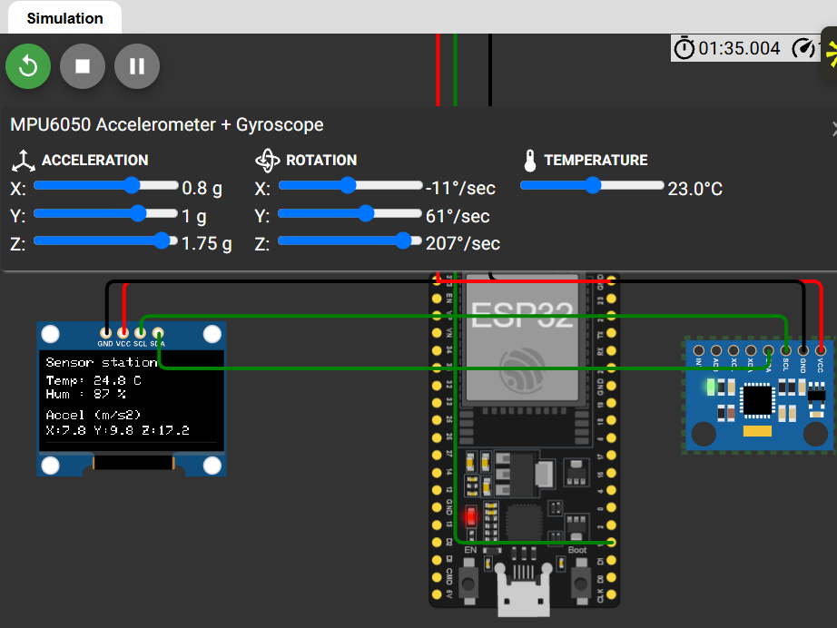
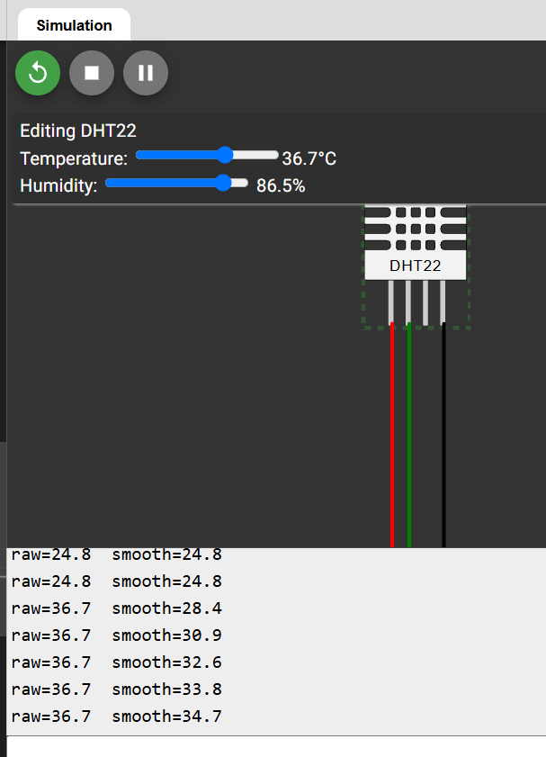

# 02 – Sensor Station (ESP32 + Wokwi)

A small weather-and-motion station running on an ESP32 in the Wokwi simulator. It reads temperature and humidity from a DHT22, reads movement from an MPU6050 accelerometer, calms down the noisy temperature with a simple filter, and shows everything live on an OLED screen.

I built this as the second step of my embedded systems self-study plan. The goal was not only to make it work, but to understand *why* each piece is there: the shared I2C wires, the smoothing formula, and the checks for failed sensor reads.



## What it does

- Reads **temperature and humidity** from a DHT22 every 2 seconds (the sensor needs that rest time).
- **Smooths the temperature** so the screen does not jump around because of small sensor noise.
- Reads **acceleration (X, Y, Z)** from an MPU6050 and refreshes the screen 5 times per second.
- Shows temperature, humidity and acceleration on a 128×64 **OLED screen**.
- Prints both the raw and the smoothed temperature on the **Serial Monitor** so the effect of the filter can be compared.
- Handles **failed sensor reads** without freezing the whole program.

## Hardware (all simulated in Wokwi)

| Part | Role | How it talks to the ESP32 |
|---|---|---|
| ESP32 DevKit | The controller | – |
| SSD1306 OLED 128×64 | Display | I2C, address `0x3C` |
| MPU6050 | 3-axis accelerometer + 3-axis gyroscope | I2C, address `0x68` |
| DHT22 | Temperature and humidity | Its own single data wire |

## Wiring

| From | To (ESP32 pin) |
|---|---|
| OLED VCC | 3V3 |
| OLED GND | GND |
| OLED SDA | 21 |
| OLED SCL | 22 |
| MPU6050 VCC | 3V3 |
| MPU6050 GND | GND |
| MPU6050 SDA | 21 (shared with the OLED) |
| MPU6050 SCL | 22 (shared with the OLED) |
| DHT22 VCC | 3V3 |
| DHT22 GND | GND |
| DHT22 SDA (data) | 15 |

**Why these pins:** on the ESP32, pins 21 and 22 are the usual I2C pins, so the standard setup works without surprises. Pin 15 is a free ordinary pin, good for the DHT22 data wire. The DHT22 pin called NC (not connected) is left empty.


## How to run it

1. Open the project in Wokwi: **https://wokwi.com/projects/477945391772484609**
2. Make sure these libraries are added in the Library Manager:
   - `Adafruit SSD1306`
   - `Adafruit GFX Library`
   - `DHT sensor library`
   - `Adafruit MPU6050`
3. Press the green **Play** button.
4. Click the DHT22 or the MPU6050 in the circuit to open their sliders, and change the values while the simulation runs.

## How it works

### I2C: two devices on the same two wires

I2C is a way for chips to talk using only two wires shared by every device:

- **SDA** carries the data, bit after bit.
- **SCL** carries the clock, a steady beat that tells the receiver when to read each bit.

Every device has its own **address**, like a house number. The ESP32 says an address first, and only the device with that number listens. This is why the OLED (`0x3C`) and the MPU6050 (`0x68`) can share the same pins 21 and 22 without mixing up.

In the code, three places matter:

- `Wire.begin(21, 22);` turns I2C on and chooses the pins.
- `oled.begin(SSD1306_SWITCHCAPVCC, OLED_ADDR);` and `mpu.begin(0x68, &Wire);` tell the ESP32 who to talk to. If nobody answers at that address, the program says so and stops.
- `oled.display();` is the moment the picture is sent to the screen. Nothing appears before this line.

One thing worth knowing: the **DHT22 does not use I2C**. It has its own single-wire protocol, handled by the DHT library. In this project, I2C is used by the screen and by the MPU6050.

### Smoothing the temperature (exponential filter)

A real sensor is never perfectly steady. Even in a room where nothing changes, the DHT22 might report 24.0, 24.6, 23.7, 24.3... To keep the display calm, each new reading is mixed with the previous smoothed value:

```cpp
smoothTemp = ALPHA * t + (1 - ALPHA) * smoothTemp;
```

With `ALPHA = 0.3`, every update takes **30% of the new reading** and **70% of the old value**. One strange reading has little power. Several readings in a row that agree have a lot of power, and that is exactly the difference between noise and a real change.

Example: the room is steady near 24 °C, then really becomes 28 °C at reading 6.

| Reading # | Raw | Smoothed |
|---|---|---|
| 1 | 24.0 | 24.0 |
| 2 | 24.6 | 24.2 |
| 3 | 23.7 | 24.0 |
| 4 | 24.3 | 24.1 |
| 5 | 24.1 | 24.1 |
| 6 | 28.0 | 25.3 |
| 7 | 28.2 | 26.2 |
| 8 | 27.9 | 26.7 |
| 9 | 28.1 | 27.1 |

The small jumps are ignored, and the real change is followed after a few readings. The price of smoothing is that small delay.

**Choosing ALPHA:** it is a dial between "calm" and "fast". A small ALPHA is calm but slow, a big one is fast but lets noise through, and `ALPHA = 1` means no smoothing at all. A practical way to choose: decide how long you accept to wait before the display shows 90% of a real change. If that is `n` readings, then

```
ALPHA = 1 - 0.1^(1/n)
```

For my room-temperature display I accept about 13 seconds (7 readings at 2 s each), which gives `ALPHA ≈ 0.3`.

| ALPHA | Readings to reach 90% of a real change | Time at 2 s per reading |
|---|---|---|
| 0.1 | about 22 | about 44 s |
| 0.2 | about 10 | about 20 s |
| 0.3 | about 7 | about 13 s |
| 0.5 | about 4 | about 7 s |
| 0.9 | 1 | 2 s |



## Demo


https://github.com/user-attachments/assets/34f2d064-cfcf-4df7-9168-e4dd09be810f


## What I learned

- **I2C:** two shared wires carry many devices, and the address decides who listens. When a device does not answer, the first things to check are the wires and the address.
- **The filter:** mixing each new reading with the old value turns a nervous sensor into a readable display, and ALPHA is the dial between calm and fast.

## Project structure

```
02-sensor-station/
├── README.md
├── sensor_station.ino
├── i2c_scanner.ino
└── screenshots/
    ├── 01-circuit.png
    ├── 02-oled-running.png
    ├── 03-serial-raw-smooth.png
    ├── 05-i2c-scanner.png
    └── 06-oled-not-found.png
```
