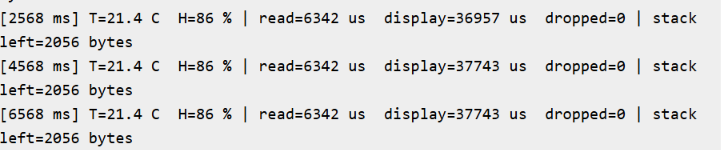
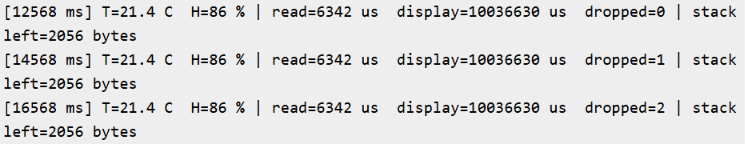
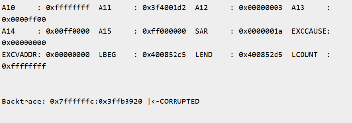

# 03 – FreeRTOS Multitasking (ESP32 + Wokwi)

A sensor station that does three jobs at the same time on an ESP32 running in the Wokwi simulator: one task reads the DHT22, one task draws the values on an OLED screen, and one task prints a log line on the Serial Monitor. The tasks never touch each other directly. They talk through queues, and they share their timing numbers through a mutex.

I built this as the third step of my embedded systems self-study plan, on top of the circuit from [02 – Sensor Station](../02-sensor-station). The goal was not only to make it work, but to understand *why* each piece is there: the priorities, the waiting lines (queues), the key to the shared notebook (mutex), and the size of each task's stack.


## What it does

- A **reader task** reads temperature and humidity from the DHT22 every 2 seconds, with an exact rhythm.
- It puts a copy of each reading in two queues: one for the display and one for the logger.
- A **display task** sleeps until a reading arrives, then draws it on the 128×64 OLED screen.
- A **logger task** sleeps until a reading arrives, then prints one line on the Serial Monitor with the reading, the timing of each task, the number of dropped messages and the free stack.
- **Measures its own timing**: how long the sensor read and the screen drawing take, in microseconds.
- **Never blocks on a full queue**: if a queue is full, the message is dropped and counted.

## Hardware (all simulated in Wokwi)

The circuit is the same as in project 02, without the accelerometer.

| Part | Role | How it talks to the ESP32 |
|---|---|---|
| ESP32 DevKit | The controller (FreeRTOS is already built into it) | – |
| SSD1306 OLED 128×64 | Display | I2C, address `0x3C` |
| DHT22 | Temperature and humidity | Its own single data wire |

## Wiring

| From | To (ESP32 pin) |
|---|---|
| OLED VCC | 3V3 |
| OLED GND | GND |
| OLED SDA | 21 |
| OLED SCL | 22 |
| DHT22 VCC | 3V3 |
| DHT22 GND | GND |
| DHT22 SDA (data) | 15 |

**Why these pins:** the same choices as project 02. Pins 21 and 22 are the usual I2C pins on the ESP32, and pin 15 is a free ordinary pin for the DHT22 data wire.

## How to run it

1. Open the project in Wokwi: **TODO: add your Wokwi project link**
2. Make sure these libraries are added in the Library Manager:
   - `Adafruit SSD1306`
   - `Adafruit GFX Library`
   - `DHT sensor library`
3. Press the green **Play** button.
4. Watch one log line appear every 2 seconds in the Serial Monitor. Click the DHT22 to change its values while the simulation runs.

## How it works

### The four words behind the project

- **Task:** a small program that runs on its own, like a worker with one job.
- **RTOS (FreeRTOS):** the manager that decides which task runs now and which one waits.
- **Queue:** a waiting line. One task drops a message in it and another task picks it up, in order.
- **Mutex:** the key to a shared notebook. Only the task holding the key may write in it, so two tasks never write at the same time.

### The pipeline

```
                    ┌──────────────┐
                    │  readerTask  │  priority 2 (most important)
                    │ reads DHT22  │  every 2 s
                    └───────┬──────┘
              puts a copy   │   puts a copy
            ┌───────────────┴───────────────┐
            ▼                               ▼
   ┌─────────────────┐             ┌─────────────────┐
   │  displayQueue   │             │    logQueue     │
   │ (5 messages)    │             │ (10 messages)   │
   └────────┬────────┘             └────────┬────────┘
            ▼                               ▼
   ┌─────────────────┐             ┌─────────────────┐
   │  displayTask    │             │   loggerTask    │
   │ draws on OLED   │             │ prints on Serial│
   └────────┬────────┘             └────────┬────────┘
            │ writes displayUs              │ reads stats
            └──────────►  stats  ◄──────────┘
                    (protected by statsMutex)
                   readerTask also writes here
```

### The five key ideas in the code

1. **Priorities.** `xTaskCreate(...)` gives the reader priority 2 and the other two tasks priority 1. If two tasks want the CPU at the same moment, the reader goes first, because it is the one with strict timing.
2. **An exact rhythm.** The reader ends its loop with `vTaskDelayUntil(...)`. It wakes up every exact 2 seconds, even if the work itself took a different time. A plain `delay()` would add the work time to the wait and slowly drift.
3. **Sleeping while waiting.** The display and logger tasks call `xQueueReceive(..., portMAX_DELAY)`. They sleep and use no CPU until a message arrives, so the other tasks can work. This is the big advantage over a single `loop()`.
4. **Never wait on a full queue.** The reader sends with a timeout of 0: `xQueueSend(..., 0)`. If the queue is full, the message is dropped and the counter `dropped` goes up. A reader that waits forever could miss its own rhythm.
5. **A mutex around the shared numbers.** Three tasks write or read the `stats` notebook (reader time, display time, dropped count). Each one takes the key with `xSemaphoreTake`, does a very short job, and gives it back with `xSemaphoreGive`.

Only the display task touches the screen. If two tasks used the I2C wires, the screen would need its own mutex too.

## Measurements

Measured in the **Wokwi simulation**, so these values are not the same as on a real board. I will compare them when I have the real hardware.



## Experiments

| # | What I changed | What I observed |
|---|---|---|
| 1 | Added `delay(3000);` in the display task, after `oled.display();` | ) |
| 2 | Reduced the logger stack from 4096 to 1024 bytes | The board crashed and kept restarting (see below) |

### The stack overflow

With a 1024-byte stack for the logger, the board printed a `Guru Meditation Error` (`IllegalInstruction`) with `PC: 0xffffffff` and a `Backtrace` marked `CORRUPTED`. Then it rebooted again and again, and the watchdog timer reset it too.



What happened, in simple words: every task has a small stack, a notepad where it writes where to return after each function call. With 1024 bytes, the logger's notepad was too small for `Serial.printf`. The writing spilled outside the notepad and overwrote the return addresses. When the function tried to return, the chip jumped to an address that does not exist (`0xffffffff`) and crashed.


## Demo

[](demo.mp4)


## What I learned

- **Tasks and queues:** a queue lets tasks work without touching each other's data. A task that waits on a queue sleeps and uses no CPU.
- **Priorities and timing:** `vTaskDelayUntil` keeps an exact rhythm, and priority only matters when tasks compete for the CPU.
- **Mutex:** a shared notebook needs a key. Keeping the time with the key as short as possible keeps the other tasks from waiting.
- **Stack size:** a stack that is too small does not give a clear error. It corrupts the return addresses and crashes in a confusing way. The safe way is to measure the real usage with `uxTaskGetStackHighWaterMark` and add a margin.

## Project structure

```
03-freertos-multitasking/
├── README.md
├── freertos_station.ino
└── screenshots/
    ├── 01-serial-log.png
    └── 03-stack-overflow.png
```
